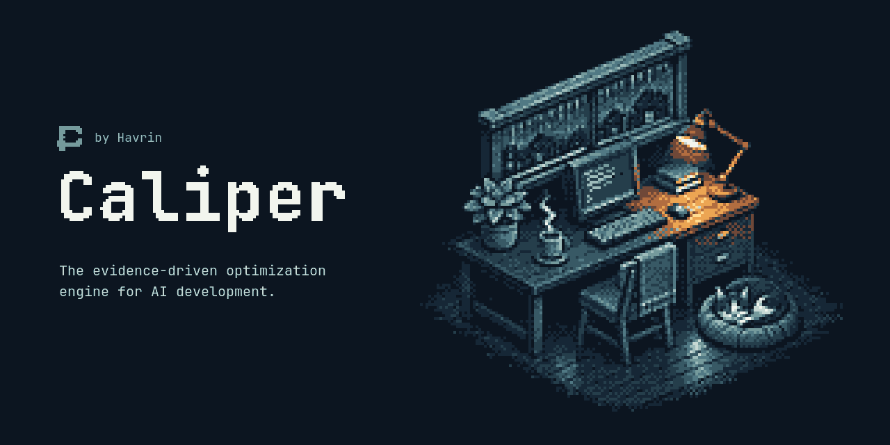
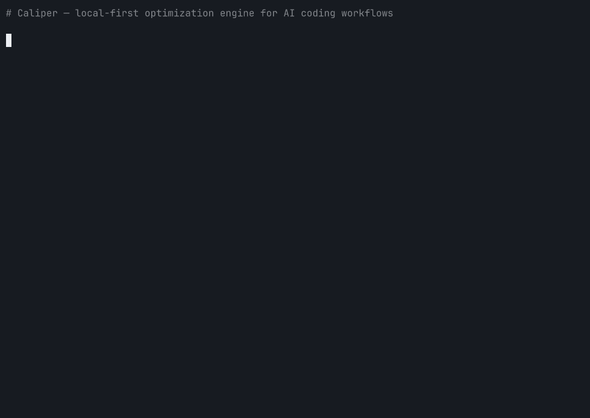

# Caliper by Havrin

[](https://github.com/vouion/caliper/actions/workflows/ci.yml)
[](https://www.npmjs.com/package/@vouion/caliper)
[](LICENSE)
[](https://nodejs.org)

<p align="center">
  
</p>

**The open-source optimization engine for AI-powered development.**

Caliper analyzes how you actually work with AI coding agents, finds evidence-backed inefficiencies in your sessions and configuration, and tells you what to change — without sending your data anywhere, and without needing an LLM.

> Caliper is an open-source project by **Havrin**. Local-first · evidence-driven · provider-agnostic · Apache-2.0.

<p align="center">
  
</p>

<p align="center"><sub>Real output on synthetic demo data (<code>caliper demo</code>) · <a href="assets/demo.cast">asciinema cast</a> · audit → fix prompt → verified experiment</sub></p>

## Why Caliper

Usage dashboards tell you *what* you spent. Caliper tells you *what was wasted and why*:

- **Stuck loops** — the same tool call with identical input failing over and over.
- **Redundant context spend** — files re-read repeatedly without changing.
- **Unverified edits** — sessions that modify code but never run a test.
- **Context pressure** — sessions that compact their context repeatedly.
- **Configuration waste** — MCP servers you never call, duplicate skills, plaintext secrets in config files.

Every finding carries supporting evidence, a confidence level, consequences, and a concrete recommendation with apply/rollback steps. Nothing is transmitted. No account. No LLM required.

**Honest positioning:** session *observation* is a crowded space (ccusage, Decant, Sniffly, and others do it well). Caliper's focus is the next step: deterministic **workflow-quality diagnostics** across agents, plus **controlled experiments that verify whether a recommended change actually helped** — not just suggest it. See [docs/research/competitive-landscape.md](docs/research/competitive-landscape.md) for a sourced comparison, including where competitors already beat us.

## Install

Requires **Node.js ≥ 22.13** (uses the built-in SQLite module; no native dependencies).

```sh
npm install -g @vouion/caliper

# or from source:
git clone https://github.com/vouion/caliper && cd caliper
npm install && npm run build
npm link                     # puts `caliper` on your PATH
```

Runtime dependencies: exactly one (`smol-toml`, BSD-3-Clause, for Codex config parsing). Everything else is Node built-ins.

## Quickstart

```sh
caliper doctor                      # check agent installs + storage health
caliper audit                       # analyze the last 30 days, all agents
caliper audit --since 7d --agent claude
caliper audit --json > audit.json   # machine-readable output
caliper report --format json        # re-render the last saved audit
caliper trend                       # finding-count deltas across recent audits
caliper prompt --agent claude --output fix.md   # agent-ready prompt to apply the fixes
caliper demo                        # synthetic dataset — no personal data needed
```

Supported agents are discovered automatically from their standard install locations — no configuration needed. No session data yet? `caliper demo` runs the full pipeline on a clearly-labeled synthetic dataset that exercises every diagnostic rule.

## Supported agents

| Agent | Storage analyzed | Verified against | Notes |
|---|---|---|---|
| **OpenCode** | `~/.local/share/opencode/opencode.db` | v2.3.1 | SQLite, read-only; credential tables never queried |
| **Codex CLI** | `~/.codex/sessions/**/rollout-*.jsonl` | 0.169.1 | Tool failures inferred from output (tagged heuristic) |
| **Claude Code** | `~/.claude/projects/**/*.jsonl` | 2.1.308–2.1.327 | Split-record usage dedup; reported `is_error` failures; sidechain/subagent stats; compaction boundaries; cost-state totals |

Session schemas are version-sensitive. Caliper probes the layout before reading, degrades gracefully on unknown layouts, and reports partial parses instead of guessing. Legacy OpenCode JSON storage (pre-2.x) is detected and reported as unsupported. More agents are planned via the same adapter interface.

### Claude Code specifics

- **Correct token accounting.** Claude Code splits one API response into multiple transcript records, each repeating the full usage block. Caliper merges records by message id and counts usage exactly once (verified against 5,434 real multi-record groups; parsed totals cross-checked against agent-reported `cost-state`).
- **Reported failures, not guesses.** Tool errors come from `tool_result.is_error`; interrupted calls are distinguished from failures.
- **Subagent visibility.** Sidechain activity is summarized per session (turns, tool calls, errors) and in report totals.
- **Honest costs.** Dollar figures come from Claude Code's own `cost-state` and are suppressed when it flags unknown model pricing. Tokens are always shown; costs are never invented.
- **Private files stay private.** `~/.claude.json` and `.credentials.json` are never opened. Transcript text, tool inputs/outputs, thinking, attachments, and API-request blobs never enter Caliper's model (sentinel-tested).

## What Caliper does

| Capability | Status |
|---|---|
| Detect OpenCode, Codex CLI, and Claude Code installations | ✅ |
| Read-only ingestion with incremental caching (unchanged sessions never re-parsed) | ✅ |
| Environment scan: configs, MCP servers, skills, instruction files | ✅ |
| 8 deterministic diagnostic rules with evidence + confidence, across all three agents | ✅ |
| Recommendations with lifecycle states linked to experiments | ✅ |
| Agent-ready fix prompts (`caliper prompt`) — provider-agnostic, content-free | ✅ |
| Trend view (`caliper trend`) — finding-count deltas across audits | ✅ |
| **Experimentation engine**: reproducible baseline-vs-candidate comparisons | ✅ |
| Isolated trial workspaces, seeded execution order, multi-trial repetition | ✅ |
| Deterministic correctness verification (Caliper runs the tests, not the agent) | ✅ |
| Correctness-first verdicts with explicit confidence (verified/preliminary/inconclusive) | ✅ |
| Experiment registry: fingerprints, trial results, recovery, duplicate protection | ✅ |
| OpenCode execution backend (interface-verified); Codex/Claude backends (unverified, gated) | ✅ / ⚠ |
| Terminal + JSON reports; `doctor` health checks; provider attribution | ✅ |
| Synthetic demo datasets (audit + experiment), zero cost | ✅ |
| Software discovery, auto-apply, leaderboards | 🗺 roadmap — **not implemented** |

Audit recommendations are **observational, not experimentally verified** (`tested: false`). Only an experiment verdict of `verified-improvement` represents a proven improvement — and that requires ≥5 trials with a large effect. Caliper never applies changes for you.

## Generate a fix prompt

`caliper prompt` turns the last audit into a single, ready-to-paste prompt that instructs **your own coding agent** to apply the fixes — closing the loop from diagnosis to action while keeping Caliper itself hands-off (no auto-apply).

```sh
caliper audit                                  # diagnose first
caliper prompt                                 # print the prompt (generic agent)
caliper prompt --agent claude --output fix.md  # tailor to Claude Code, save to a file
caliper prompt --min-severity high             # only high-severity fixes
caliper prompt --json                          # structured { prompt, recommendationCount, ... }
caliper prompt --demo                          # try it on synthetic data, no audit needed
```

The prompt is **deterministic and zero-LLM** — templated from the same content-free model as the report. It contains:

- **Operating rules** for the agent: minimal reversible changes, back up configs, never print/commit/transmit secrets, verify with tests, never weaken tests, and write a rollback changelog.
- **Prioritized fixes** (highest severity first), each with the evidence, concrete apply steps, rollback, and trade-offs — plus an honest `observational (not experimentally verified)` label.
- **Agent tailoring** (`--agent generic|opencode|codex|claude`) so durable instruction changes land in the right file (e.g. `CLAUDE.md` vs `AGENTS.md`).
- A **definition of done** so the agent reports what it changed and how to undo it.

It carries findings, evidence pointers, and instructions — never raw session content or secret values. Pasting it into a cloud agent is your explicit choice; Caliper itself transmits nothing. After the agent applies the fixes, re-run `caliper audit --since 7d` to check recent behavior and `caliper trend` to see progress; use an experiment to verify any change that matters.

## Track progress

Session findings are **historical patterns** — fixing your workflow prevents them in *future* sessions, it doesn't erase past ones. Progress shows up over time, and `caliper trend` makes it visible:

```sh
caliper trend              # history table + delta since your last audit
caliper audit --since 7d   # focus on recent behavior after applying fixes
```

Each audit records a content-free snapshot (counts only). `caliper trend` shows findings by severity and rule, what's newly firing, and what's no longer firing. It flags window changes and notes that a decrease may be a fix *or* a session aging out of the window — never false certainty. Environment findings (config) clear immediately once fixed; session findings improve as clean sessions accumulate.

## Experiments

Caliper can now **prove** whether a configuration change helps, on your own tasks:

```sh
caliper experiment demo        # free end-to-end demo (mock agents, real test verification)

caliper experiment create \
  --benchmark builtin:fix-failing-test \
  --baseline baseline.json --candidate candidate.json \
  --trials 5 --recommendation rec-repeated-tool-failures

caliper experiment run <id> --dry-run          # preview the trial plan
caliper experiment run <id> --approve-inference  # real agents: explicit approval required
caliper experiment report <id> --format json
caliper experiment list
caliper experiment inspect <id>
```

A benchmark defines the starting repository state, task prompt, acceptance checks, and limits. Each trial runs in a **fresh isolated workspace** (template copy or local git clone — your real repos are never touched), in seeded-random order, with hard timeouts and process-group termination. After the agent finishes, **Caliper itself runs the acceptance checks** — including a test-file hash check so an agent cannot "pass" by deleting tests. Metrics (tokens, cost, tool calls, errors) come from the existing content-free session adapters.

The verdict is correctness-first: a faster configuration that produces incorrect code never wins. Efficiency only decides when correctness is comparable and both time and tokens improve materially. Small samples yield `preliminary` or `inconclusive` — never false certainty.

**Safety gates:** real-agent runs perform paid model inference and require `--approve-inference`. Codex/Claude execution backends are implemented but not yet verified against live installs and additionally require `--allow-unverified`. OpenCode is the primary verified backend. Mock configurations run free and are used by all automated tests.

```
RESULTS
  Metric              baseline-slow*  candidate-fast
  Task success                   0/3             3/3
  Avg time                     223ms           106ms
  Output tokens                11.4k            7.2k
  Test failures                    3               0
  * baseline · — = unavailable (not zero)

VERDICT
  Winner: Candidate (mock, applies fix) · confidence: preliminary
  Recommendation state: experiment-completed
    Correctness decides: task success 0/3 (0%) vs 3/3 (100%). A faster
    configuration that produces incorrect code is not superior.
```

## The eight rules

| Rule | Fires when | Confidence |
|---|---|---|
| `repeated-tool-failures` | Same tool + byte-identical input fails ≥2× in a session (≥5 → high severity) | high; medium if any error evidence is heuristic |
| `retry-loops` | ≥3 consecutive identical non-read calls, or ≥2 consecutive real assistant errors, or ≥3 provider retries | high |
| `redundant-file-reads` | Same file read ≥3× with ≥2 re-reads of unchanged content (reads between writes count per segment) | high |
| `missing-test-verification` | ≥3 completed file edits, ≥3 assistant turns, and zero test commands observed in-session (failed test runs still count as verification) | medium (tests may run outside the agent) |
| `context-compaction-pressure` | ≥2 compactions in one session | high |
| `unused-mcp-servers` | Configured MCP server with no matching tool calls in analyzed sessions (`server_tool` and `mcp__server__tool` conventions) | medium (naming-convention inference) |
| `skill-name-collisions` | Same skill id in multiple skill directories | high |
| `plaintext-config-secrets` | Secret-looking config keys holding literal values (values never inspected) | high |

Thresholds are deliberately conservative. Absence of findings is not a guarantee of optimality.

## Performance (real collection, measured)

Benchmarked against a real Claude Code install with **5,422 sessions (1.81 GB)** on Node 26, Linux, `--all --limit 1000`:

| Metric | Value |
|---|---|
| Sessions discovered / analyzed / skipped (limit) | 5,422 / 1,000 / 4,422 |
| Malformed / failed reads | 1 partial (154 MB transcript, size-guarded) / 0 |
| Initial ingestion | ~2.1 s |
| Subsequent cached run | ~0.6 s (1,000/1,000 cache hits) |
| Peak RSS | ~325 MB (large-transcript parsing); steady-state heap ~40–70 MB |

Transcripts >128 MB are skipped with an explicit warning rather than risking memory exhaustion.

## Privacy & security

- **Local-only.** No network calls during analysis. No telemetry. No account. Experiments run agents locally; any inference cost is the agent's own, explicitly approved by you.
- **Read-only.** Agent databases/files are opened read-only and never modified (tested byte-for-byte).
- **Content-free reports.** Reports contain metrics, timestamps, tool names, file paths, and fingerprints — never message text, tool output, or raw tool input. Tool error messages are truncated and secret-redacted (redaction before truncation). Config parse errors never echo file content. Free text is control-character-sanitized before terminal rendering.
- **Credentials are out of scope by construction.** OpenCode's credential tables are never queried; Claude's `~/.claude.json`/`.credentials.json` are never opened; config values under secret-looking keys are never retained — only the key path is flagged.
- **Experiments store no conversation content.** The registry holds benchmark definitions, configuration fingerprints, and content-free metrics. Agent stdout goes to transient capped files that are deleted after structural parsing. Trial workspaces are isolated and deleted unless you opt to keep them.
- **Disclosed exception:** session *titles* are user-derived free text (often LLM-summarized). They are truncated to 120 chars and included for usability; treat reports as sensitive if titles may be.
- **Your Caliper state** (`~/.local/share/caliper/`) is written with `0600` permissions.

Details: [docs/PRIVACY.md](docs/PRIVACY.md).

## Development

```sh
npm install
npm test          # node:test suite (218 tests), no test framework dependency
npm run typecheck
npm run build     # tsc → dist/
node --experimental-strip-types src/cli.ts audit   # run from source
```

Architecture: [docs/ARCHITECTURE.md](docs/ARCHITECTURE.md). Roadmap: [ROADMAP.md](ROADMAP.md). Changelog: [CHANGELOG.md](CHANGELOG.md). Agent/contributor conventions: [AGENTS.md](AGENTS.md).

## License

Apache-2.0. See [LICENSE](LICENSE) and [NOTICE](NOTICE).

---

<p align="center">
  <b>Caliper</b> is an open-source project by <b>Havrin</b>.<br/>
  Built with evidence, not hype. If it helps your workflow, consider <a href="https://github.com/sponsors/vouion">sponsoring</a> or <a href="https://buymeacoffee.com/vouion">buying a coffee</a>.
</p>
